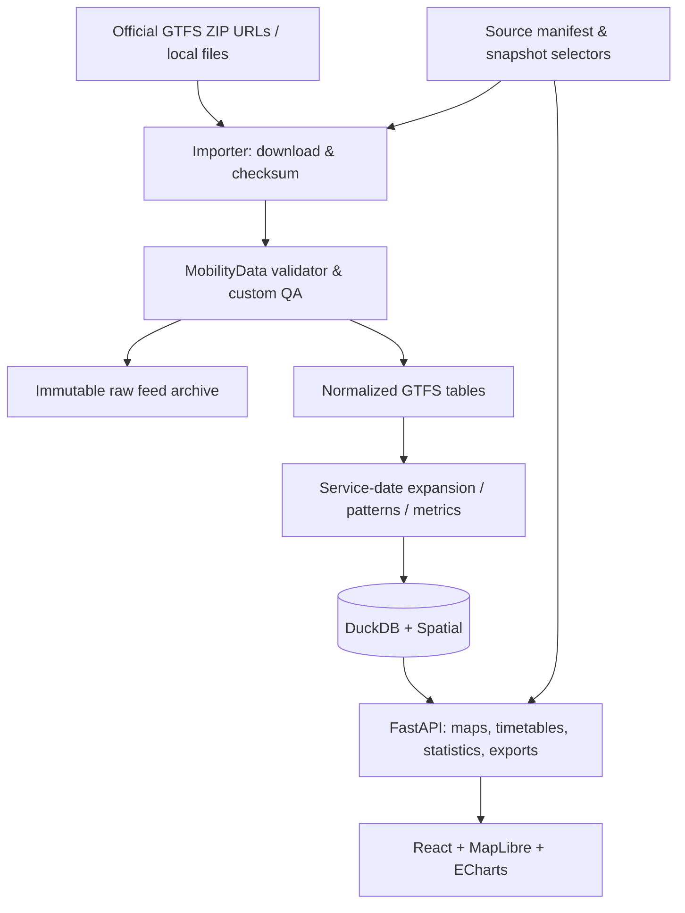
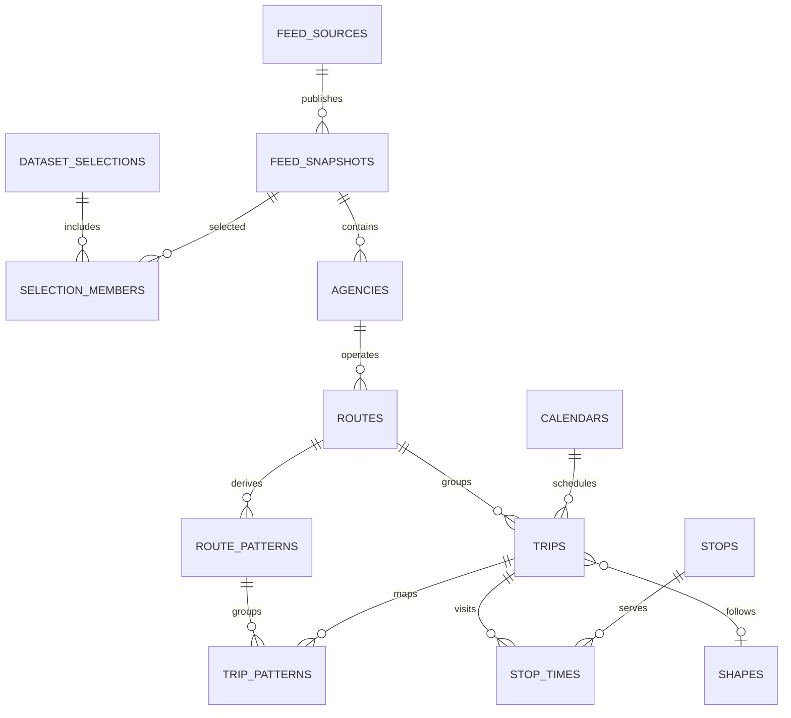

# Transport Atlas: MVP specification, data model and implementation plan

**Version:** 1.0 (proposal, 2026-11-06)  
**Audience:** Solo developer / AI coding agent  
**Deployment:** Local-first Windows web application, loopback-only  
**Pilot:** Sardinia, Italy; architectural support for other regions and cross-border networks  
**Primary product goal:** Explore and quantitatively compare documented fixed-route public transport networks and schedules by region, service date, mode, operator, route, pattern and stop.

## 1. Success criteria and boundaries

A successful MVP can ingest at least four independently sourced GTFS Schedule ZIP feeds; show their bus/rail/tram/ferry route geometries and stops on one map; switch a calendar date and distinguish active from inactive services; show actual stop-level departures and full trip stop-time sequences; calculate defensible stop-, pattern- and operator-level service statistics; and export selected results as CSV/GeoJSON. It must show source, provenance, feed validity, and missing-data warnings.

The app describes **all documented and imported services**, not necessarily all services in reality. Data absence must never be portrayed as proof of transport absence. No user account, cloud backend or paid mapping API is required. It is an analysis dashboard, not a production journey planner.

**Included in MVP:** multi-feed imports, archive of raw GTFS snapshots, feed validation, geographically filtered route/stop map, pattern inspection, calendar-aware timetables, stop departures, descriptive service statistics, source/quality panel, CSV and GeoJSON exports.

**Deferred:** real-time feeds, fare search, itinerary optimization, reliable walking transfers, end-to-end travel-time isochrones, NeTEx ingestion, fully automated national feed discovery, live alerts, mobile apps, public hosting, and complex GTFS-Flex booking scenarios.

## 2. Pilot feed catalogue

Start with the regional Sardegna Mobilità open-data portal: `https://www.sardegnamobilita.it/open-data/trasporti`.

Priority imports:
1. ARST — regional bus/rail services.
2. ATP Sassari — urban/suburban services.
3. Trenitalia Sardegna — heavy rail.
4. ASPO Olbia — urban buses.

Next candidates: CTM Cagliari, ATP Nuoro, other publicly funded local operators, ferries to minor islands and Corsica. Each source needs a manifest entry with publisher, download URL, dataset page, license/attribution, retrieval date, update policy, transport mode coverage, geographic coverage, and any manual notes. Check actual feed files, not solely portal descriptions, to establish modes, operators, and valid service dates.

Feed-directory integration (Mobility Database and Transitland) is later or supplementary; the importer must work on a user-supplied ZIP or a direct official URL without third-party credentials.

## 3. System architecture



**Technology:** Python 3.12+; FastAPI; DuckDB and spatial extension; Pandas or Polars; React + TypeScript + Vite; MapLibre GL JS; ECharts; Pytest, Vitest and Playwright. Begin with bounded, simplified GeoJSON per viewport; consider vector tiles/PMTiles only when performance thresholds are missed. Use a permissively licensed or properly attributed base map, respecting tile-host terms and quotas.

**Concurrency:** one backend process controls database writing. Import under a process-wide lock; browsing may use a consistent active-snapshot view. To avoid partially visible reloads, stage and validate each imported snapshot before atomically changing the active-snapshot selection.

## 4. Functional UX specification

**Desktop layout:**
- Header: region, service date, optional comparison date, source snapshot set, search.
- Left navigation: modes, operators, route lists, region boundaries, advanced filters.
- Map: routes/patterns, stops, operator/mode colors, hover, select, viewport fit, legend.
- Right inspector (tabbed): Route, Pattern, Stop, Trip, Timetable, Provenance.
- Bottom analytics panel: departure histogram, service-span chart, metrics and CSV/GeoJSON export.

**Interactions:**
1. Region selection loads the chosen geography and lists available datasets, not just map features.
2. Changing the date updates `active_on_date`, counts, departures and warnings without losing route selection.
3. Clicking a route shows route metadata and pattern alternatives. Clicking a pattern draws its exact geometry and stop order and lists scheduled trips on the date.
4. Clicking a stop shows departures ordered by local departure time, line, destination, and source. Show both stop-local and agency service-day date when relevant.
5. Toggle `All imported routes` vs `Operating on selected date`. Inactive routes can remain muted; expired feeds show an explicit warning, not a zero-service assertion.
6. Display an unambiguous line/variant/direction distinction; never collapse different stop sequences into a single direction row.
7. Every detail card contains source dataset, snapshot retrieved time, valid service date span, geometry quality and warnings.
8. Export the filtered table with the filters and snapshot IDs included in metadata (sidecar manifest for files).

**Map rule:** Draw geometry from GTFS `shapes.txt` when available. If absent, draw a dashed *schematic stop-to-stop connection*, not a claimed road/rail alignment. Map layers distinguish real feed geometry, approximated connections, and OSM contextual infrastructure.

## 5. Canonical data model

### 5.1 Identity conventions

- A `source_id` identifies a feed publisher/source over time. A `snapshot_id` identifies an immutable imported ZIP (UUID or content-addressed ID). Never treat raw `route_id`, `stop_id`, `trip_id`, `service_id`, or `shape_id` as globally unique.
- The identity of a raw GTFS record is `(snapshot_id, raw_gtfs_id)`; `stop_times` additionally uses `stop_sequence` or an importer-assigned row sequence if upstream malformed.
- A `dataset_selection_id` selects one snapshot per configured source for a coherent map/analysis session. Include it in every analytical query cache key. Do not combine historical and current snapshots of one feed as if they were separate operators.
- Source `agency_id` can be missing in permitted single-agency feeds: resolve canonical agency identity at import without misrepresenting the original field.
- `route_pattern_id` is derived per snapshot from `(route_id, direction_id, ordered stop sequence, pickup/dropoff semantics, shape/geometry variant)`; it is **not** a GTFS official identifier. Preserve raw route, trip, stop and shape fields for auditing.
- For physical-stop matching across feeds, maintain a separate *reviewable* `stop_cluster` mapping. Do not automatically merge similar names or nearby platforms into one stop.

### 5.2 Core entities and fields

| Entity | Key fields / relationships | Purpose |
|---|---|---|
| `regions` | `region_id`, `name`, `country_code`, `tz_hint`, `boundary_geom` | Named geographic scope; a feed may cross borders |
| `feed_sources` | `source_id`, `publisher`, `url`, `landing_url`, `license`, `attribution`, `enabled` | Provenance and discovery |
| `feed_snapshots` | `snapshot_id`, `source_id`, `sha256`, `fetched_at`, `zip_path`, `import_status`, `feed_start`, `feed_end`, `qa_summary` | Immutable, auditable version |
| `dataset_selections` | `selection_id`, `name`, `created_at`, `is_default` | Consistent collection of snapshots |
| `selection_members` | `selection_id`, `source_id`, `snapshot_id` | Exactly one snapshot per source |
| `agencies` | `snapshot_id`, `agency_id`, `name`, `url`, `timezone` | Actual agencies/operators |
| `routes` | `snapshot_id`, `route_id`, `agency_id`, `short_name`, `long_name`, `route_type`, `color` | Public-facing named services |
| `stops` | `snapshot_id`, `stop_id`, `name`, `latitude`, `longitude`, `location_type`, `parent_station`, `timezone` | Stops, platforms, station hierarchy |
| `calendars` | `snapshot_id`, `service_id`, weekday flags, `start_date`, `end_date` | Recurring service rules |
| `calendar_exceptions` | `snapshot_id`, `service_id`, `date`, `exception_type` | Additions/removals, including holidays |
| `shapes` | `snapshot_id`, `shape_id`, `geom` (ordered LineString), `quality` | Geographic trip alignment |
| `trips` | `snapshot_id`, `trip_id`, `route_id`, `service_id`, `shape_id`, `direction_id`, `headsign`, `block_id` | Individual timetable patterns/trips |
| `stop_times` | `snapshot_id`, `trip_id`, `stop_sequence`, `stop_id`, `arrival_sec`, `departure_sec`, `pickup_type`, `drop_off_type`, `timepoint` | Timed sequence of stops |
| `frequencies` | `snapshot_id`, `trip_id`, `start_sec`, `end_sec`, `headway_secs`, `exact_times` | Frequency-based operation |
| `transfers` | `snapshot_id`, source/target stop, transfer type, min transfer sec | Published transfer constraints (optional in feed) |
| `route_patterns` | `pattern_id`, `snapshot_id`, `route_id`, `direction_id`, `stop_signature`, `shape_id`, `geometry_quality` | Derived route variants |
| `trip_patterns` | `snapshot_id`, `trip_id`, `pattern_id` | Trip to pattern mapping |
| `stop_clusters` / `stop_cluster_members` | canonical cluster, `(snapshot_id, stop_id)`, method, confidence, review status | Optional cross-feed physical stop matching |
| `qa_issues` | `snapshot_id`, `issue_code`, `severity`, `entity_type`, `raw_id`, `details` | Data reliability |
| `source_regions` | `source_id`, `region_id`, `relationship` | Many-to-many spatial coverage |

**Indexes/materialization:** index composite raw IDs; precompute ordered pattern-stop arrays, pattern geometries, a per-date `active_service` cache for the selected date window, and stop departures for frequently requested dates. Do not pre-expand an unbounded calendar indefinitely.

**Minimal relationship diagram:**



The diagram simplifies composite IDs; all GTFS entity joins must also constrain `snapshot_id`.

### 5.3 Example DuckDB schema fragment

```sql
CREATE TABLE feed_sources (
  source_id VARCHAR PRIMARY KEY,
  publisher VARCHAR NOT NULL,
  download_url VARCHAR,
  landing_url VARCHAR,
  license_name VARCHAR,
  attribution_text VARCHAR,
  enabled BOOLEAN NOT NULL DEFAULT true
);

CREATE TABLE feed_snapshots (
  snapshot_id VARCHAR PRIMARY KEY,
  source_id VARCHAR NOT NULL,
  content_sha256 VARCHAR NOT NULL,
  fetched_at TIMESTAMPTZ NOT NULL,
  raw_zip_path VARCHAR NOT NULL,
  import_status VARCHAR NOT NULL,
  effective_start DATE,
  effective_end DATE,
  validation_report_path VARCHAR
);

CREATE TABLE routes (
  snapshot_id VARCHAR NOT NULL,
  route_id VARCHAR NOT NULL,
  agency_id VARCHAR,
  short_name VARCHAR,
  long_name VARCHAR,
  route_type INTEGER NOT NULL,
  route_color VARCHAR,
  PRIMARY KEY (snapshot_id, route_id)
);

CREATE TABLE trips (
  snapshot_id VARCHAR NOT NULL,
  trip_id VARCHAR NOT NULL,
  route_id VARCHAR NOT NULL,
  service_id VARCHAR NOT NULL,
  shape_id VARCHAR,
  direction_id INTEGER,
  headsign VARCHAR,
  block_id VARCHAR,
  PRIMARY KEY (snapshot_id, trip_id)
);

CREATE TABLE stop_times (
  snapshot_id VARCHAR NOT NULL,
  trip_id VARCHAR NOT NULL,
  stop_sequence INTEGER NOT NULL,
  stop_id VARCHAR NOT NULL,
  arrival_sec INTEGER,
  departure_sec INTEGER,
  pickup_type INTEGER,
  drop_off_type INTEGER,
  timepoint INTEGER,
  PRIMARY KEY (snapshot_id, trip_id, stop_sequence)
);
```

The final migration must include the other entities above and enforce/validate join integrity, even where source feeds are malformed. Retain optional raw GTFS columns in staging tables/Parquet so nothing important is thrown away.

## 6. Timetable semantics and algorithms

This section is **non-negotiable** for analytical validity.

### A. Active service on selected date D
1. Compute whether `calendar.txt`'s date interval and weekday flag include D.
2. Apply `calendar_dates.txt` overrides: `exception_type=1` adds D, `exception_type=2` removes D. Support feeds whose entire service schedule is defined by `calendar_dates.txt` with no `calendar.txt`.
3. Select trips with active `service_id` in this snapshot. A trip belongs to one **service day**, which is not necessarily the same as the wall-clock date of all its arrivals.
4. For GTFS `frequencies.txt`: do not count the template `trip_id` as a single literal departure. If `exact_times=1`, instantiate its fixed schedule appropriately; if `exact_times=0`, represent frequency/headway service without claiming exact departure times.
5. GTFS time values may exceed `24:00:00` and must be stored as *integer seconds since the GTFS service-day origin*, not modulo-24 clock strings. Convert to actual zoned timestamps only at the display/output boundary, applying GTFS agency timezone and daylight-saving rules. Handle ambiguous/nonexistent DST local wall times using GTFS-defined time semantics, not naïve midnight addition.
6. On a stop's wall-clock date, departures from the previous GTFS service day may still be relevant. The stop board must query applicable preceding service days, not solely D, and distinguish service date from local event time.
7. Preserve missing/estimated times and `timepoint` status. Never fabricate exact departures or arrival times for non-exact frequency service.

**Examples:**
- A Monday service with an arrival at `25:15:00` represents an early-Tuesday event belonging to Monday's service day.
- A school-day exception may add a route on a Wednesday otherwise excluded by its normal weekly calendar.
- An `exact_times=0` service with headway 20 minutes supports an *approximate three departures per hour*, not specific 09:00/09:20/09:40 promises.

### B. Route-pattern derivation
Group trips into a pattern using exact ordered boarding/alighting stop sequence plus direction and route identity; track optional shape variants separately when geometry differs. Preserve trip-specific headsings, calendars and time sequences. Avoid using `direction_id` as an eastbound/westbound label unless supported by actual data.

### C. Geometry
Use GTFS `shape_id` and the ordered `shapes.txt` coordinates. Missing or invalid shapes produce flagged schematic lines connecting stops; don't map-match onto streets by default. Region boundaries clip the *view*, not the underlying interregional trip data.

### D. Metrics, with units and caveats
- `scheduled_departures_per_stop` = departures within selected local date/window (count exact trips only; headway estimates separate).
- `active_trips_per_route` = trip instances with service on date D, with frequency data distinguished.
- `service_span` = first scheduled departure through last scheduled departure for a chosen stop / route pattern / date.
- `median_departure_interval_min` = median of gaps between consecutive departures at a specific stop, direction/pattern and selected service window; do not call it a globally representative route frequency.
- `routes_per_stop` = distinct imported routes serving that stop; physical-stop clusters must be opt-in.
- `geography_coverage` = stops/routes within viewport/region, not a claim about population access; population accessibility is future scope.
- `quality` = observed completeness indicators (missing shapes, missing calendar coverage, validator errors, expired sources). No ungrounded global completeness percentage.
- `simple connectivity` = common stops/official transfer edges and direct service adjacency; don't claim feasible passenger transfers or shortest journeys without a transfer/routing model.

## 7. API contract v1

Common query fields: `selection_id` (or explicit active selection), `region_id`, `date` (ISO `YYYY-MM-DD`), `mode`, `source_id`, `agency_id`; all paginated list endpoints return total count and warnings. Selected dataset versions must be explicit in all responses.

| Method / endpoint | Response |
|---|---|
| `GET /api/v1/regions` | Region IDs, names, map bounds, available sources |
| `GET /api/v1/sources` | Source catalog and freshness/validity |
| `GET /api/v1/selections` | Coherent sets of imported snapshots |
| `GET /api/v1/routes?region_id=...&date=...&mode=...&bbox=...&active_only=true` | Paginated route summaries and pattern counts |
| `GET /api/v1/routes/{route_key}` | Route details, variants, service status and provenance |
| `GET /api/v1/patterns/{pattern_id}` | Ordered stops, geometry, direction and geometry quality |
| `GET /api/v1/patterns/{pattern_id}/trips?date=...` | Operating trip instances/times and frequency service |
| `GET /api/v1/stops?bbox=...` | Stops and serving-route counts |
| `GET /api/v1/stops/{stop_key}/departures?date=...&from=...&to=...` | Scheduled departure board with service date, times and warnings |
| `GET /api/v1/analytics/service?region_id=...&date=...` | Trip counts, stop counts, frequency summaries, QA indicators |
| `GET /api/v1/qa?selection_id=...` | Feed quality, expired feeds, missing geometries, import issues |
| `GET /api/v1/map/patterns.geojson?...` | Bounded/simplified GeoJSON with stable pattern IDs |
| `GET /api/v1/export?kind=routes|departures|patterns&format=csv|geojson` | Export with provenance / analysis metadata |

**Example departure object:**

```json
{
  "selection_id": "sardinia-current",
  "snapshot_id": "<snapshot-uuid>",
  "trip_id": "<original-gtfs-id>",
  "stop_id": "<original-gtfs-id>",
  "service_date": "2026-11-06",
  "gtfs_departure_seconds": 90900,
  "local_departure_datetime": "2026-11-07T01:15:00+01:00",
  "timezone": "Europe/Rome",
  "departure_precision": "scheduled",
  "geometry_quality": "source-shape"
}
```

This is an illustrative response shape, **not** an assertion that such a departure exists. The service-day time conversion in this specific example is for an ordinary non-DST-transition date.

**Data import interface:** start with `python -m transport_atlas import --source <source_id>` and `--file <path>`, using a source manifest. Local administration can later expose guarded POST endpoints.

## 8. Import pipeline

1. Read source manifest; check license/terms, direct URL access, optional ETag/last-modified.
2. Download to a temporary directory; impose ZIP size, extraction size and path-traversal protections. Generate SHA-256 checksum; skip unchanged content.
3. Store the original ZIP immutably in `data/raw/<source_id>/<sha256>.zip`.
4. Run MobilityData's GTFS Validator; preserve machine-readable or HTML reports. Separate warnings from fatal errors.
5. Parse GTFS tables preserving raw string IDs and optional fields. Normalize dates and HH:MM:SS to integer seconds. Verify composite foreign keys and coordinate bounds.
6. Build canonical records, ordered shapes and pattern signatures. Create optional clusters without merging raw stop identities.
7. Run custom checks: calendar validity, missing/duplicate shapes, obviously invalid coordinates, discrepancies between declared and effective service dates, overlapping source coverage.
8. Stage and materialize a new snapshot. Mark successful only when invariants hold. Retain failed ZIP and diagnostic report as nonactive record.
9. Update a coherent dataset selection to include the snapshot, preserving previous selections for historical analysis.
10. Invalidate caches keyed by selection, date and filters; render source/quality notices.

**Directory layout:**

```text
transport-atlas/
  README.md
  docs/
    MVP_SPEC.md
    DATA_DICTIONARY.md
    API_CONTRACT.md
    QA_POLICY.md
  frontend/
    src/components/ src/pages/ src/api/ src/state/
  backend/
    transport_atlas/api/
    transport_atlas/ingest/
    transport_atlas/models/
    transport_atlas/analysis/
    transport_atlas/geospatial/
    tests/unit/ tests/integration/ tests/fixtures/
  configs/
    sources.yaml
    regions.yaml
  data/                # gitignored except README
    raw/
    validation/
    transport_atlas.duckdb
    cache/
  scripts/
  .github/workflows/
```

## 9. Implementation work packages and acceptance gates

### M0 — Repo scaffold and contracts
- Create mono-repo with Python/TS tooling and locked dependencies, source config, fixtures, CI for code/tests, local launcher.
- Define data dictionary, endpoint response types, importer return status and error codes.
- **Gate:** one command starts a working frontend and backend; test suites run locally; no credentials committed.

### M1 — Feed ingestion and QA
- Import at least four Sardinian GTFS feeds; archive exact original bytes; validate; normalize into DuckDB; build coherent selection.
- Add feed health report and import CLI.
- **Gate:** all imported entity counts reproducible; double-import is idempotent; overlapping GTFS raw IDs from separate feeds never collide; failed import cannot replace a working selection.

### M2 — Geographic atlas
- Build viewport map, layer filters, stop/route/pattern inspectors, source-shape geometry and schematic fallback; check bounds, map performance and data references.
- **Gate:** route/pattern/stop selection correctly resolves original GTFS records and source snapshots; active vs inactive mode works after date selection.

### M3 — Schedule engine
- Implement calendar/calendar_dates, over-midnight GTFS service times, `frequencies.txt`, timezone processing, departure boards and trip stop sequences.
- **Gate:** golden test fixtures reproduce expected service on dates, holidays, overnight events and fixed vs headway-based frequency cases.

### M4 — Analytics, export and hardening
- Add stop-level departures, service-span and departure-gap statistics, comparison of two service dates, QA summary, CSV/GeoJSON export, E2E checks and documentation.
- **Gate:** every exported value is traceable to a snapshot; UI shows missing/expired feed warnings; no unexplained differences between analytical and detail-view counts.

After M4, import Corsica as a **cross-region compatibility test**, not as an excuse to hard-code Corsican logic into the schema.

## 10. Regression test matrix (minimum)

| Fixture | Expected invariant |
|---|---|
| Two feeds contain `route_id=1` | Both independent routes persist |
| Same source imported twice unchanged | Only one content snapshot or idempotent no-op |
| Updated feed changes route IDs | Previous snapshot remains queryable |
| `calendar_dates.txt` only | Date exceptions are sufficient to create active services |
| Weekly calendar plus removal exception | No service for removed date |
| `25:15:00` GTFS stop time | Preserves service day and correct next-wall-day event |
| DST changeover in Europe/Rome | Correctly interprets GTFS agency service-day times |
| `frequencies.txt` `exact_times=0` | No invented exact trip departures |
| `frequencies.txt` `exact_times=1` | Correct count and timestamps of fixed service instances |
| Trip has missing `shape_id` | Flagged schematic geometry; all stops still inspectable |
| Same stop name at two physical platforms | Not silently merged |
| Feed valid range excludes selected date | Expired/out-of-coverage warning, not proof of no service |
| Failed import mid-transaction | Existing active dataset remains unchanged |
| GTFS IDs use non-ASCII strings | Round-trip retained exactly |
| A route crosses the region boundary | Original trip and full stop sequence remain recoverable |
| Import ZIP contains path traversal or huge expansion | Safe rejection, no unintended disk writes |

## 11. Performance and reliability targets (acceptance thresholds, not promises)

Measured on a documented representative development computer with imported Sardinia feeds:
- Initial local map and UI usable within **5 seconds** after backend startup (warm cache).
- Initial regional route layer rendered within **3 seconds** under normal local conditions.
- Date switch and refreshed service statistics within **2 seconds** with materialized/cached date selection.
- Stop departure query within **500 ms** p95 for moderate-sized response windows.
- No freezing when zooming/panning at default region scale; add spatial filtering and tiling if targets are missed.
- 100% of raw imported records traceable to a source snapshot; errors and incompleteness never silently dropped.

These are engineering targets to measure and revise against the actual feed sizes; not guaranteed outcomes.

## 12. Quality, rights and privacy

- Keep original feed licenses/attribution and check permitted data uses and any download conditions, even for personal/private work. Attribute OSM and any map-tile providers according to their terms.
- Bind the local server to `127.0.0.1` by default; do not expose writable administrative endpoints publicly.
- Store optional API tokens in ignored local environment/configuration, never repo code.
- Do not make the interactive display dependent on a third-party metered geocoding or routing service.
- Preserve validation report, raw ZIP SHA-256, imported timestamp, effective service dates and source URL for every snapshot.
- Treat data freshness, source coverage, timetable precision and geometry certainty as distinct fields; a score cannot replace these facts.

## 13. Expansion strategy

1. **More of Sardinia:** all available fixed-route feeds and ferries, with explicit feed catalogue coverage.
2. **Corsica:** validate multi-country, cross-border ferry and operator-timezone design.
3. **Country packages:** region/source manifest (`country/region`, discovery URLs, known agencies), processed in geographic batches, not hard-coded app forks.
4. **Advanced transport analytics:** temporal reachability, boarding/transfer graph and accessibility maps; add OpenTripPlanner/OSM when actual journeys and walking transfers are necessary.
5. **Historical comparisons:** compare archived snapshots with clear distinction between schedule changes and provider-data changes.
6. **Other standards:** NeTEx adapters feeding the canonical model without discarding source-native metadata.
7. **Integration with TravelCompiler:** optional exported validated services/travel-time evidence, with provenance and staleness warnings; separate codebases and development lifecycles.

## 14. Suggested first coding assignment

Implement **M0 and the smallest testable slice of M1** only:
- monorepo scaffold and local launcher;
- 1 source manifest entry for ARST plus a local fixture;
- raw GTFS ZIP archive + checksum;
- GTFS parser for agencies, routes, stops, trips, stop_times, calendars/calendar_dates and shapes;
- normalized DuckDB tables with composite snapshot keys;
- CLI command `import --file` and a command that prints route/trip/stop counts for a selected date;
- unit tests for cross-feed key collision, exception calendars, `25:15:00`, and failed import atomicity.

Do **not** start by polishing a map UI with fictitious transport data. Establish verifiable source-to-query correctness first.

## Sources consulted (accessed November 6, 2026)

- GTFS Schedule reference: https://gtfs.org/documentation/schedule/reference/
- GTFS best practices: https://gtfs.org/documentation/schedule/schedule-best-practices/
- Sardegna Mobilità open data: https://www.sardegnamobilita.it/open-data/trasporti
- MobilityData GTFS validator: https://github.com/MobilityData/gtfs-validator
- Mobility Database catalog API: https://mobilitydata.github.io/mobility-feed-api/SwaggerUI/index.html
- MapLibre GL JS: https://maplibre.org/maplibre-gl-js/docs/
- DuckDB Spatial: https://duckdb.org/docs/stable/core_extensions/spatial/overview.html
- DuckDB concurrency: https://duckdb.org/docs/stable/connect/concurrency.html
- OpenTripPlanner: https://docs.opentripplanner.org/
